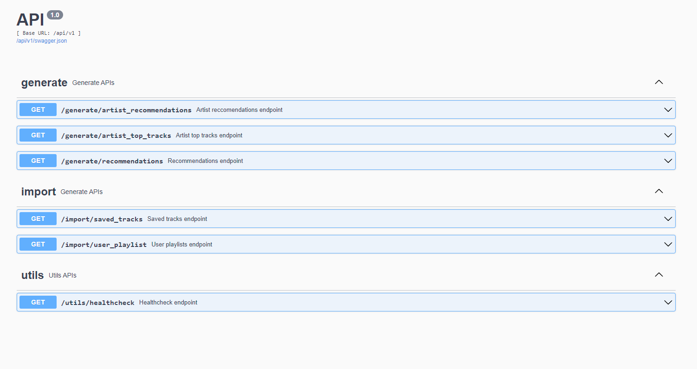

# REST API reference

Base path: `/api/v1`. Interactive documentation with request/response schemas:
`http://<host>:5183/api/v1/docs/`.



## Import

| Method | Path | Parameters | Response |
|---|---|---|---|
| `GET` | `/import/user_playlist` | none | `{"status":"ok","message":"Importing a random playlist"}` |
| `GET` | `/import/saved_tracks` | none | `{"status":"ok","message":"Importing your saved tracks"}` |

Both start the corresponding scheduler job in a background thread and return immediately.
"Random" is literal: the job imports one playlist, the same one the scheduler would pick.

## Generate

| Method | Path | Parameters | Response |
|---|---|---|---|
| `GET` | `/generate/artist_top_tracks` | none | `{"status":"ok","message":"Generating a random artist top tracks playlist"}` |
| `GET` | `/generate/artist_recommendations` | none | *deprecated job, see below* |
| `GET` | `/generate/recommendations` | none | *deprecated job, see below* |

`artist_top_tracks` requires at least one artist playlist to exist, i.e.
`ARTIST_PLAYLIST_ENABLED=1` and a completed `scan_library`.

!!! warning "Recommendations are gone upstream"

    Spotify removed `/v1/recommendations` in December 2024. The two recommendation
    endpoints are still declared but their jobs are not registered, so they cannot do
    anything useful. Do not build automation on them.

## Utils

| Method | Path | Parameters | Response |
|---|---|---|---|
| `GET` | `/utils/healthcheck` | none | `Ok!` (plain text) |

The healthcheck is also what the container `HEALTHCHECK` uses. It does **not** verify
Spotify or Subsonic connectivity — use **Check Subsonic** in the UI for that.

## Errors

- `200` — accepted, job started.
- `206` — "no artists found in your library" for the artist endpoints (the request was
  valid but there is nothing to do).

!!! warning "Known limitation: failures are not reported as HTTP errors"

    When an endpoint raises (Spotify unreachable, Subsonic credentials wrong, ...), the
    global handler renders the **HTML** error page with status `200` and the exception
    repr in the body. `curl -f` therefore does **not** fail. Check the body
    (`grep '"status"'` / look for HTML) instead of relying on the status code, and read
    **System → Logs** for the traceback. This is tracked upstream and will change; the
    documented behaviour above is what the current release does.

## curl recipes

```bash
# healthcheck
curl -fsS http://127.0.0.1:5183/api/v1/utils/healthcheck

# start a Liked Songs import
curl -fsS http://127.0.0.1:5183/api/v1/import/saved_tracks

# start one artist top-tracks playlist
curl -fsS http://127.0.0.1:5183/api/v1/generate/artist_top_tracks
```

There is no endpoint to rescan a **specific** playlist by UUID; use the web interface for
that, or call `import/user_playlist` repeatedly.
