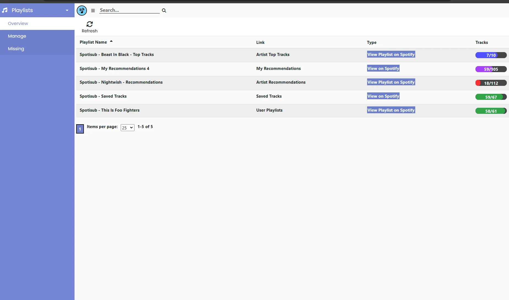

# The dashboard

The dashboard is the page you land on: `/overview/` (also served at `/`).

Each row is a playlist Spotisub manages on your server.

| Column | Meaning |
|---|---|
| **Playlist Name** | The name on the Subsonic server, normally `Spotisub - <name>` |
| **Type** | Which job owns it: `user_playlists`, `saved_tracks`, `artist_top_tracks`, ... |
| **Link** | Opens the playlist on Spotify (or a generic Spotify link for generated ones) |
| **Tracks** | How many tracks matched / how many the Spotify playlist has |

Click a row to open the [playlist detail](playlist-detail.md).

## Where the rows come from

Two scheduled jobs create and refresh them:

- `init_jobs` (every hour) discovers new Spotify playlists and creates an **empty**
  playlist row for each,
- `scan_library` (every 24 hours) does the same for your library's artists.

Nothing is imported yet at that point. The **Rescan** button, or the per-type jobs
(`saved_tracks`, `user_playlists`, ...), does the actual import. This is deliberate:
importing during boot would block the interface for minutes.

!!! note "Empty dashboard after a fresh install"

    The initial playlist scan is warmed in the background and its errors are swallowed
    on purpose, so a wrong Subsonic password shows up as an empty dashboard rather than
    a crash. Use **Check Subsonic**, then reload.
