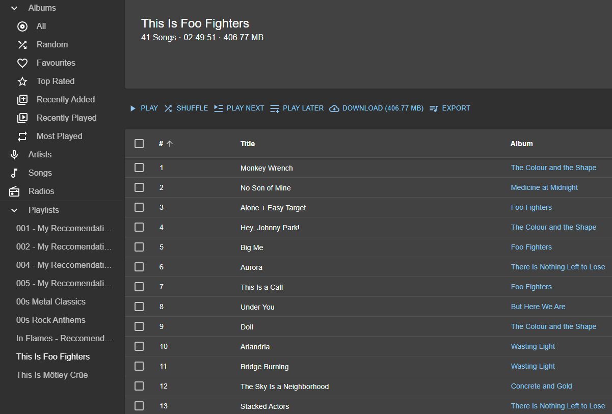

# Spotisub

**Spotisub imports your Spotify playlists into your own music server, and keeps them
in sync.** It works with [Navidrome](https://www.navidrome.org/) and every other
server that speaks the Subsonic API (Airsonic, Gonic, Astiga, Ampache, ...).

You point it at your Spotify account and at your music server. Spotisub then:

- reads your Spotify playlists, liked songs and (optionally) artists,
- finds each track in **your** library,
- writes real playlists on the server with a `Spotisub - ...` prefix,
- shows you exactly which tracks could not be found, so you can fix or ignore them,
- refreshes everything on a schedule, so playlists stay current.

Spotify does not let other software read your playlists without your permission, so
Spotisub runs on **your** machine and uses **your own** Spotify app credentials. Nothing
is sent anywhere else: the database, the OAuth token and the logs stay in a `cache/`
folder next to the container.

---

## What Spotisub does

-   :material-playlist-music: **Playlist import**

    ---

    Your Spotify playlists, created and refreshed on your server as normal playlists
    your phone, Sonos or car can play.

-   :material-heart: **Liked songs**

    ---

    One playlist with everything in your Spotify *Liked Songs*, kept up to date.

-   :material-account-music: **Artist top tracks** *(optional)*

    ---

    A "Top Tracks" playlist for each artist you own, so an artist page is never empty.

-   :material-magnify-scan: **Missing-track report**

    ---

    A per-playlist view of every track Spotisub could not find, with one-click ignore
    and re-scan.

-   :material-download: **Optional auto-download**

    ---

    Hook up [spotdl](integrations/spotdl.md) and missing tracks are downloaded to your
    music folder automatically, optionally gated by [Lidarr](integrations/lidarr.md).

---

## Start in four steps

-   **1. Create a Spotify app**

    ---

    Five minutes in the Spotify developer dashboard. You need a Client ID and a Client
    Secret, and you must register one redirect URI.

    [:octicons-arrow-right-24: Create the Spotify app](getting-started/spotify-app.md)

-   **2. Install Spotisub**

    ---

    One command with the installer script, or a two-file `docker compose` setup if you
    prefer to see what runs.

    [:octicons-arrow-right-24: Install with Docker](getting-started/docker.md)

-   **3. Log in to Spotify**

    ---

    Open Spotisub, create your local account, press *Connect Spotify* and approve the
    prompt. This happens once.

    [:octicons-arrow-right-24: First login](getting-started/first-run.md)

-   **4. Import a playlist**

    ---

    Press *Rescan*, watch the jobs list, and open the playlist to see what matched and
    what did not.

    [:octicons-arrow-right-24: First import](getting-started/first-import.md)

---

## Requirements at a glance

| You need | Why |
|---|---|
| A Subsonic-compatible server with your music in it | That is where the playlists are written |
| A **Spotify Premium** account | The playlists come from there, and Spotify requires Premium for Web API access since February 2026 |
| A Spotify *app* (Client ID + Secret) | Spotify requires it for any third-party client |
| Docker, or Python 3.10+ if you run from source | The way Spotisub is packaged |

!!! warning "Spotify Premium is required"

    Since Spotify's February 2026 developer policy, Development Mode requires the
    account that owns the app to have Premium — a free account gets the Web API
    blocked with `403`. [spotdl](integrations/spotdl.md) needs Premium for its own
    reason: it uses Spotify's streaming endpoints.

---

## Where to go next

- Never used Docker? → [Install with the script](getting-started/install-script.md)
- Something does not work? → [Troubleshooting](help/troubleshooting.md)
- Tracks are missing? → [Missing tracks](guide/missing-tracks.md) and
  [How matching works](guide/matching.md)
- Want to change behaviour? → [Environment variables](configuration/environment-variables.md)
- Automating with scripts? → [REST API](api/endpoints.md)

!!! note "This site replaces the old wiki"

    Everything that used to live in the GitHub wiki is here, rewritten and extended.
    The [release history](release-history.md) is generated from `CHANGELOG.md` in the
    repository.

---

## Buy me a coffee

Spotisub is a spare-time project: no ads, no telemetry, no paid tier. If it earned a
place in your setup, a one-off tip pays for the time behind the next fix.

GitHub also shows its built-in **Sponsor** button on the repository, configured in
[`.github/FUNDING.yml`](https://github.com/blastbeng/spotisub/blob/dev/.github/FUNDING.yml),
with the same two options.
